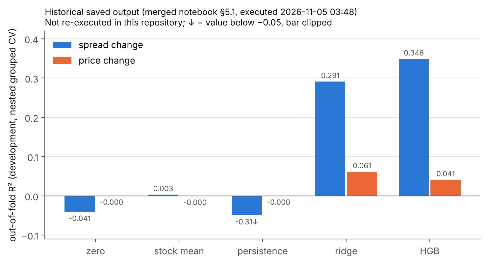

# Order-Book Forecasting: Price, Liquidity, and Trading Value

*Erdős Institute team project, Fall 2026 · repository `fall-2026-short-horizon-forecasting`*

**Question.** Using only the first five minutes of a stock's limit order book, can we forecast the
next five minutes' **mid-price return** and **change in average bid-ask spread**? And if we can,
do those forecasts produce better **simulated trading decisions after paying the spread and fees**?

**Data.** The Kaggle *Optiver Realized Volatility Prediction* order books and trades: 112 stocks,
3,830 ten-minute windows and 428,932 stock-windows, rebuilt on a one-second grid from past quotes only.

**Short answer so far.** In the team's saved development results, the spread change is far more
predictable than the price return (out-of-fold R² ≈ 0.35 vs ≈ 0.06). Yet in every development fold
the trading rule chose **not** to use the spread forecast. Better spread prediction did not
translate into a better decision under the tested rule. The trading profit and robustness numbers
in the original notebook have **no saved outputs**, so they are listed below as unverified until the
pipeline in this repository is run on the data.


*Study design. Top: each sample uses order-book seconds 0–299 as inputs; the simulated
trade buys one share at the ask at second 300 and sells at the bid at second 599. Bottom: whole
windows stay together in every split; heads and trading rules are chosen on inner folds and scored
once on outer folds; 20% of windows form a previously examined benchmark.*

## Results and their status

Each headline result is recorded with its target, model, features, split and how far it has been
verified. The full list with source cells is in
[`results/metrics/headline_claims.csv`](results/metrics/headline_claims.csv), generated by
[`scripts/audit_source_notebooks.py`](scripts/audit_source_notebooks.py).

| Result | Target | Model / inputs | Split and evaluation | Status |
|---|---|---|---|---|
| Spread-change R² **0.348** (ridge 0.291; stock mean 0.003; persistence −0.313) | log(S2/S1) | HGB, selected in every fold / 47 inputs | development windows, 5 × 3 nested grouped CV, out-of-fold | Saved output (historical); not re-executed here |
| Price-return R² **0.061** (HGB 0.041; zero −0.000) | mid return 299→599, bps | ridge, selected / 47 inputs | same | Saved output (historical); not re-executed here |
| Spread filter never chosen (τ = ∞ in 5/5 folds) | trading rule | rule grid on inner forecasts | inner folds of each outer fold | Saved output (historical) |
| Upgraded models: spread 0.380, price 0.070 | both | LightGBM; Huber-LGBM + ridge / 131 inputs | same folds | **Unverified**: source cell has a saved `NameError` |
| Trading: +0.32 bps/opportunity (CI 0.21–0.44), window-level t 2.8 | net bps | price-only rule on the **§5 models** (not the upgraded ones) | development, nested | **Unverified**: no saved output |
| Cost already known from current spread (R² 0.81); oracle cost does not help | crossing cost | ridge / oracle | development, nested | **Unverified**: no saved output |
| Random-row split inflates price R² ≈ 4.6× | both | HGB | grouped vs random 5-fold | **Unverified**: saved `NameError` |
| Benchmark: spread 0.358, price 0.029, +0.19 bps/opp (CI 0.03–0.36), t 1.4 | both | §5 models refit on development | legacy benchmark, previously examined | **Unverified**: no saved output |
| Price R² 0.937 (exploration notebook) | **price level**, not return | ridge | different window split | **Superseded**: not return-prediction skill ([archive](archive/README.md)) |
| Model inputs: 47 baseline / 131 upgraded (31 extra raw) | — | — | — | Computed here from the ported code and tested |



*Historical forecast accuracy: out-of-fold R² by model and target, parsed from the saved §5.1 output of the archived
merged notebook (development windows). Historical reference values, not re-executed in this repository.*

**What the finding does and does not say.** The saved fold selections show that adding a
spread-forecast filter to the price-hurdle rule was never preferred on inner folds. The archived
narrative explains why: the current quoted spread already predicts the crossing cost well, and price
forecast errors are far larger than cost errors (unverified). The finding applies to **the tested
filter on the tested rule**. It does not show that spread forecasts cannot improve trading in general.

## Limitations

* **No chronological ordering.** `time_id`s are shuffled, so the same days can appear in every fold
  and in the benchmark. Nothing here is an out-of-time test.
* **Previously examined benchmark.** Earlier team experiments scored the benchmark's spread outcomes
  once. They also trained price models on a different split that put roughly 80% of the benchmark
  windows in training ([details](archive/README.md#was-the-benchmark-holdout-untouched)).
* **Simplified execution.** One share at the displayed quote; no queue position, market impact
  (many stocks may trade in the same window), latency beyond 10 s or real fee schedule. Prices are
  normalised, so there is no dollar P&L, capacity, Sharpe ratio or drawdown.
* **Concentration of simulated returns.** The archived narrative reports that the best 1% of windows
  hold about 76% of the simulated profit (unverified). Treat any edge as a small, fragile
  window-level bet until §8.2 is re-run.
* **In-sample target statistics.** The upgraded models' stock target means (`te_*`) are computed on
  training rows that include each row's own target. That makes the training fit optimistic. It is
  not test leakage.

## Methods

* **Book reconstruction** ([`book.py`](src/obforecast/book.py)). Invalid level-1 snapshots
  (non-positive price or size, crossed or locked quotes) are dropped. Each second carries forward the
  latest valid quote of the same window only, and nothing is backfilled. Quote age is tracked, so
  stale-but-valid quotes can be told apart from data errors.
* **Targets.** `y_price = (m_599 / m_299 − 1) × 10⁴`. `y_spread = log(S2/S1)`, where S1 and S2 are
  the time-weighted mean relative spreads of seconds 0–299 and 300–599 (the average spread, not the
  spread at exit). The earlier spread-*widening* classification is archived.
* **Inputs** ([`features.py`](src/obforecast/features.py),
  [`feature_inventory.csv`](results/metrics/feature_inventory.csv)). 30 first-half features in 7
  families (spread, minimum-spread/tick, volatility, price/tilt, activity, depth, imbalance). On top
  of these: stock-relative versions learned on training folds, 11 **leave-one-out market** means over
  the other stocks in the same window, and relative-to-market inputs, for 47 in total. The upgraded
  set (131) adds spread-path, depth-trend and trade-print features, more market context, cross-stock
  dispersion, stock target statistics and a categorical stock id.
* **Validation** ([`validation.py`](src/obforecast/validation.py)). Folds are grouped by window. 5
  outer × 3 inner folds: heads and trading rules are chosen on inner folds and scored once on outer
  folds. The legacy benchmark split and all fold identifiers are written to `results/splits/`.
* **Models** ([`models.py`](src/obforecast/models.py)). Baselines are zero, the training-fold stock
  mean and persistence. Heads are ridge (median imputation and scaling fitted per fold) and a fixed
  `HistGradientBoostingRegressor`. The upgraded models (§5.2) use LightGBM.
* **Trading simulation** ([`trading.py`](src/obforecast/trading.py)). Long only. Enter when the price
  forecast exceeds the current relative spread + 2 × cost + margin, optionally also requiring the
  spread forecast to be ≤ τ. Margin and τ come from a small grid chosen on inner folds, with ties
  going to the simpler rule. Buy at the ask, sell at the bid. Costs of 0 / 0.5 / 1 bp per side are
  charged on top of the spread, never instead of it. Unfillable legs earn 0 rather than being dropped.
* **Robustness** ([`pipeline.py`](src/obforecast/pipeline.py)). Family ablation; lagged and
  shuffled market placebos; fresh-quote splits; concentration trims; a random-split leakage demo;
  delayed entry; cost sensitivity; and an unseen-stock test of the spread model.

## Repository layout

| Path | Contents |
|---|---|
| [`notebooks/00_data_exploration.ipynb`](notebooks/00_data_exploration.ipynb) | Corrected EDA with the final timing (inputs 0–299) |
| [`notebooks/01_forecasting_and_trading.ipynb`](notebooks/01_forecasting_and_trading.ipynb) | Main analysis walkthrough (sections as in the merged notebook) |
| [`src/obforecast/`](src/obforecast) | Loading, reconstruction, features, validation, models, simulation, figures, CLI |
| [`configs/`](configs) | `default.yaml` (full run: timing, seeds, models, fees, rule grid), `smoke.yaml` |
| [`results/`](results) | Generated metrics, figures and split identifiers ([what is in there](results/README.md)) |
| [`tests/`](tests) | Data-boundary, splitting, leakage, cost-accounting and notebook-execution tests |
| [`scripts/audit_source_notebooks.py`](scripts/audit_source_notebooks.py) | Provenance audit of the archived notebooks |
| [`archive/`](archive) | Original notebooks and an account of superseded experiments |

## Reproducing the analysis

**1. Data.** Create a Kaggle account and accept the rules of the
[Optiver Realized Volatility Prediction](https://www.kaggle.com/competitions/optiver-realized-volatility-prediction/rules)
competition. Then download and unzip it (about 3 GB):

```bash
pip install kaggle            # needs ~/.kaggle/kaggle.json (Kaggle → Settings → API → Create New Token)
kaggle competitions download -c optiver-realized-volatility-prediction -p data/
unzip -q data/optiver-realized-volatility-prediction.zip -d data/optiver-realized-volatility-prediction
```

The code expects the competition layout unchanged, under any directory you choose:

```
<data dir>/train.csv
<data dir>/book_train.parquet/stock_id=<id>/*.parquet
<data dir>/trade_train.parquet/stock_id=<id>/*.parquet
```

Point the code at it with `--data-dir`, or with `export OBF_DATA_DIR=<data dir>`. `data/` is ignored
by Git.

**2. Environment** (Python ≥ 3.10):

```bash
python -m venv .venv && source .venv/bin/activate
pip install -r requirements-dev.txt && pip install -e .
pytest                                    # 47 tests on synthetic books; no data needed
```

**3. Runs.**

```bash
# smoke run: 8 stocks, 3x2 folds, small models -> results/smoke/ (labelled "smoke", not committed)
python -m obforecast.run --config configs/smoke.yaml --data-dir "$OBF_DATA_DIR"

# full development analysis -> results/metrics, results/figures, results/splits, results/run_manifest.json
python -m obforecast.run --config configs/default.yaml --data-dir "$OBF_DATA_DIR"

# the single benchmark scoring (sections 9 and 9.1), after the development analysis is final
python -m obforecast.run --config configs/default.yaml --data-dir "$OBF_DATA_DIR" --score-benchmark

# notebooks (writes outputs into the .ipynb files)
jupyter nbconvert --to notebook --execute --inplace notebooks/00_data_exploration.ipynb
jupyter nbconvert --to notebook --execute --inplace --ExecutePreprocessor.timeout=-1 notebooks/01_forecasting_and_trading.ipynb
```

Add `--skip-upgraded` to leave out the LightGBM sections. `--stages cv,trading` runs a subset.
Every run writes `run_manifest.json` with the configuration and its hash, package versions, git
commit, per-stage runtime and status (`executed` / `skipped` / `failed` with the error), and the
split details. A failed stage is recorded, never hidden.

**Colab.** After this branch is merged, open
[00 in Colab](https://colab.research.google.com/github/Erdos-Projects/fall-2026-short-horizon-forecasting/blob/main/notebooks/00_data_exploration.ipynb)
or [01 in Colab](https://colab.research.google.com/github/Erdos-Projects/fall-2026-short-horizon-forecasting/blob/main/notebooks/01_forecasting_and_trading.ipynb). Store a `KAGGLE_API_TOKEN` in Colab Secrets, or set
`DATA_DIR` in the first cell to a folder that already holds the data. The setup cell clones the repo,
installs the requirements and downloads the data. No shared Google Drive folder is needed.

**Runtime.** Historical timings from the archived notebook's saved outputs (Colab runtime with a T4 GPU attached; the code itself is CPU-bound): feature
tables for 112 stocks ≈ 7.6 min, §5 nested CV ≈ 12.9 min. Its markdown estimates ≈ 2.5 h for §5.2
and 4–5 h for a complete run (not measured here).

**Environment tested.** The package, tests and synthetic end-to-end runs were executed with Python
3.13.18, numpy 2.5.3, pandas 3.0.5, scikit-learn 1.9.1, matplotlib 3.11.2, PyYAML 6.0.3 and pytest
9.1.1. LightGBM and pyarrow were **not** available in that environment, so the parquet loader and
the LightGBM calls were not executed. The upgraded-model plumbing was tested with a stand-in model
only. The team's Colab used pandas 2.2.3, numpy 2.4.6 and lightgbm 4.6.0.

## Not yet reproduced

Running the full pipeline on the Kaggle data is the outstanding step. Until then, every result marked
**Unverified** or **Historical** above comes from the archived notebooks, not from this code. That
covers all of §5.2–§9 (upgraded models, unseen stocks, trading, sensitivity, cost/oracle analysis,
Figure 1, ablation, stress tests, random-split leakage, correctness checks on real data, and the
benchmark). Changes in this repository that may move numbers slightly relative to the notebook:
§8.3 now learns stock means per training fold, and §9 now selects and scores **both** policies
(the notebook scored only "price only").

## Contributors

From the section labels in the team's exploration notebook and the project record:

* **Swarnendu**: data coverage checks; order-book and trade feature engineering; early
  price-level/return models (exploration notebook).
* **Francis**: the spread-change model (log S2/S1, window-grouped CV, market features) that became
  the main notebook's spread head (exploration notebook).
* **Eloise**: realized-volatility and liquidity EDA; spread-widening event classification
  (exploration notebook).
* **Nhi**: improved Francis's model and built the trading simulation and robustness checks of the
  merged notebook; repository restructuring.

*Teammates: please add surnames, GitHub handles and anything missing.*

No license file was present in the repository; none has been added. Data use is governed by the
Kaggle competition rules.
