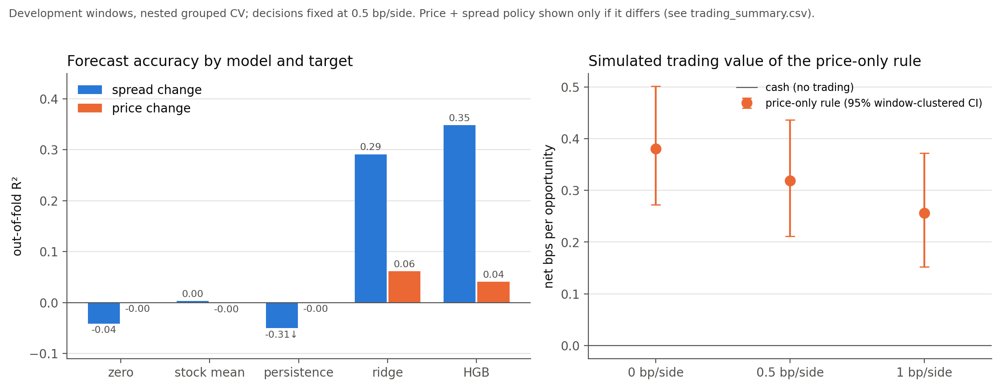
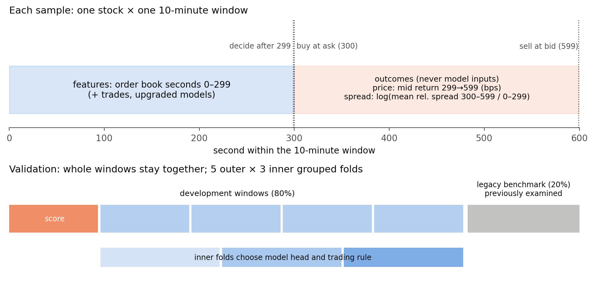

# Order-Book Forecasting: Price, Liquidity, and Trading Value

*Erdős Institute team project, Fall 2026 · repository `fall-2026-short-horizon-forecasting`*

**Question.** Using only the first five minutes of a stock's limit order book, can we forecast the
next five minutes' **mid-price return** and **change in average bid-ask spread**? And if we can,
do those forecasts produce better **simulated trading decisions after paying the spread and fees**?

**Data.** The Kaggle *Optiver Realized Volatility Prediction* order books and trades: 112 stocks,
3,830 ten-minute windows and 428,932 stock-windows, rebuilt on a one-second grid from past quotes only.

**Short answer.** Yes for liquidity, barely for price, and the better forecast was not the one
that paid. On 3,064 development windows (nested, window-grouped cross-validation), the spread change
is far more predictable than the price return (out-of-fold R² **0.348** vs **0.061**). Yet the
tested trading rule never used the spread forecast, and a weak, market-wide price signal produced a
small simulated edge after costs: **+0.32 bps per opportunity** (95% CI 0.21–0.44). All of these
numbers were re-run from this repository on the full Kaggle data, and they match the team's
original notebook.



*Figure 1. Left: out-of-fold R² of each baseline and model for the spread change (blue) and the
mid-price return (orange); development windows, 5 × 3 nested grouped CV, 47 inputs. Right:
simulated net return of the price-only rule in basis points per opportunity (no trade = 0), with
95% window-clustered bootstrap intervals, at three per-side fees (decisions fixed at 0.5 bp). The
price + spread policy is identical because the spread filter was never selected. Generated by
`python -m obforecast.run` on 2026-11-06 ([manifest](results/run_manifest.json)).*

## Results

Re-run on the full data (112 stocks, 3,830 windows, 428,932 stock-windows) with
`configs/default.yaml`. Every development figure below is computed by this repository. The archived
notebook's value is shown for comparison; the full comparison of 61 claims is in
[`reproduction_check.csv`](results/metrics/reproduction_check.csv).

| Result | Target · model · inputs | Evaluation | Re-run | Archived |
|---|---|---|---|---|
| **Spread change is predictable** | log(S2/S1) · HGB (selected 5/5 folds) · 47 | dev, nested grouped CV | R² **0.348** (ridge 0.291, stock mean 0.003, persistence −0.313) | 0.348 |
| **Price return is weakly predictable** | mid return 299→599 · ridge (selected) · 47 | same | R² **0.061** (HGB 0.041) | 0.061 |
| …and the price skill is market-wide | two-stage market-only model | same | keeps **96%** of price R² | 96% |
| **The spread filter is never chosen** | trading rule grid on inner folds | inner folds | τ = ∞ in **5/5** folds | never |
| **Small simulated edge after costs** | price-only rule on the §5 models (not the upgraded ones) | dev, nested; 0.5 bp/side | **+0.32 bps/opportunity** (CI 0.21–0.44); 21,322 trades in 1,025 windows; +5.13 bps/trade; window-level t **2.78** | +0.32 (0.21–0.44), t 2.8 |
| Why the spread forecast doesn't help this rule | crossing cost | dev, nested | current spread explains R² **0.81** of the cost (ridge 0.86); exact realised cost changes profit by **−0.005** bps (CI −0.022 to 0.011) | same |
| Robust to fees and delays | fixed decisions | dev | +0.26 at 1 bp/side; +4.18 to +4.90 bps/trade with 2–10 s entry delay; break-even fee ≈ **3.1 bp/side** | same |
| Not stale-quote catch-up; placebos fail | lagged / shuffled market inputs | 5-fold grouped | gain accrues gradually (+0.1 bps at 300 s → +10.7 at 599 s); 30 s-lagged inputs still +0.23; shuffled inputs R² −0.003, no trades | same |
| **The edge is concentrated** | window-level P&L | dev | best 1% of windows hold **76%** of the profit; dropping the 5% largest market moves leaves +0.06 | same |
| Random-row splits leak | HGB, same inputs | grouped vs random 5-fold | price R² 0.041 → 0.179 (**4.4×**); spread 0.348 → 0.356 | 4.6× (stock means were learned out of fold) |
| Upgraded models | LightGBM; Huber-LGBM + ridge · 131 | dev, same folds | *running* | 0.380 / 0.070 |
| Legacy benchmark, scored once | §5 models refit on dev | 766 previously examined windows | *not yet scored* | 0.358 / 0.029 / +0.19 bps |

All 11 correctness checks pass on the real data ([`correctness_checks.csv`](results/metrics/correctness_checks.csv)),
including look-ahead perturbation of the baseline and the 31 upgraded book/trade inputs.

**What the finding does and does not say.** The current quoted spread already predicts the cost of
crossing it, and price-forecast errors (RMSE 24 bps) dwarf cost-forecast errors (2.6 bps), so a
better spread forecast changes almost no decisions of a rule that trades on a price hurdle. This
applies to **the tested filter on the tested rule**; it does not show that spread forecasts cannot
improve trading in general. The price edge is effectively a market-timing bet on a small number of
large, trending windows.



*Study design. Each sample uses order-book seconds 0–299 as inputs; the simulated trade buys one
share at the ask at second 300 and sells at the bid at second 599. Whole windows stay together in
every split; heads and trading rules are chosen on inner folds and scored once on outer folds; 20%
of windows form a previously examined benchmark.*

### Provenance of the archived claims

[`headline_claims.csv`](results/metrics/headline_claims.csv) records what the original notebooks
could support on their own (many cells had no saved output or a saved `NameError`), and
[`archive/README.md`](archive/README.md) explains superseded experiments. In particular, the
exploration notebook's **R² ≈ 0.937 is a price-level fit**, not return-prediction skill, and its
RMSE-improvement chart used hand-typed values.

## Limitations

* **No chronological ordering.** `time_id`s are shuffled, so the same days can appear in every fold
  and in the benchmark. Nothing here is an out-of-time test.
* **Previously examined benchmark.** Earlier team experiments scored the benchmark's spread outcomes
  once. They also trained price models on a different split that put roughly 80% of the benchmark
  windows in training ([details](archive/README.md#was-the-benchmark-holdout-untouched)).
* **Simplified execution.** One share at the displayed quote; no queue position, market impact
  (many stocks may trade in the same window), latency beyond 10 s or real fee schedule. Prices are
  normalised, so there is no dollar P&L, capacity, Sharpe ratio or drawdown.
* **Concentration of simulated returns.** The best 1% of development windows hold 76% of the
  simulated profit, and dropping each strategy's own best 5% of windows turns it negative. The
  effective sample is about a thousand traded windows, not 21,322 independent trades.
* **In-sample target statistics.** The upgraded models' stock target means (`te_*`) are computed on
  training rows that include each row's own target. That makes the training fit optimistic. It is
  not test leakage.

## Methods

* **Book reconstruction** ([`book.py`](src/obforecast/book.py)). Invalid level-1 snapshots
  (non-positive price or size, crossed or locked quotes) are dropped. Each second carries forward the
  latest valid quote of the same window only, and nothing is backfilled. Quote age is tracked, so
  stale-but-valid quotes can be told apart from data errors.
* **Targets.** `y_price = (m_599 / m_299 − 1) × 10⁴`. `y_spread = log(S2/S1)`, where S1 and S2 are
  the time-weighted mean relative spreads of seconds 0–299 and 300–599 (the average spread, not the
  spread at exit). The earlier spread-*widening* classification is archived.
* **Inputs** ([`features.py`](src/obforecast/features.py),
  [`feature_inventory.csv`](results/metrics/feature_inventory.csv)). 30 first-half features in 7
  families (spread, minimum-spread/tick, volatility, price/tilt, activity, depth, imbalance). On top
  of these: stock-relative versions learned on training folds, 11 **leave-one-out market** means over
  the other stocks in the same window, and relative-to-market inputs, for 47 in total. The upgraded
  set (131) adds spread-path, depth-trend and trade-print features, more market context, cross-stock
  dispersion, stock target statistics and a categorical stock id.
* **Validation** ([`validation.py`](src/obforecast/validation.py)). Folds are grouped by window. 5
  outer × 3 inner folds: heads and trading rules are chosen on inner folds and scored once on outer
  folds. The legacy benchmark split and all fold identifiers are written to `results/splits/`.
* **Models** ([`models.py`](src/obforecast/models.py)). Baselines are zero, the training-fold stock
  mean and persistence. Heads are ridge (median imputation and scaling fitted per fold) and a fixed
  `HistGradientBoostingRegressor`. The upgraded models (§5.2) use LightGBM.
* **Trading simulation** ([`trading.py`](src/obforecast/trading.py)). Long only. Enter when the price
  forecast exceeds the current relative spread + 2 × cost + margin, optionally also requiring the
  spread forecast to be ≤ τ. Margin and τ come from a small grid chosen on inner folds, with ties
  going to the simpler rule. Buy at the ask, sell at the bid. Costs of 0 / 0.5 / 1 bp per side are
  charged on top of the spread, never instead of it. Unfillable legs earn 0 rather than being dropped.
* **Robustness** ([`pipeline.py`](src/obforecast/pipeline.py)). Family ablation; lagged and
  shuffled market placebos; fresh-quote splits; concentration trims; a random-split leakage demo;
  delayed entry; cost sensitivity; and an unseen-stock test of the spread model.

## Repository layout

| Path | Contents |
|---|---|
| [`notebooks/00_data_exploration.ipynb`](notebooks/00_data_exploration.ipynb) | Corrected EDA with the final timing (inputs 0–299) |
| [`notebooks/01_forecasting_and_trading.ipynb`](notebooks/01_forecasting_and_trading.ipynb) | Main analysis walkthrough (sections as in the merged notebook) |
| [`src/obforecast/`](src/obforecast) | Loading, reconstruction, features, validation, models, simulation, figures, CLI |
| [`configs/`](configs) | `default.yaml` (full run: timing, seeds, models, fees, rule grid), `smoke.yaml` |
| [`results/`](results) | Generated metrics, figures and split identifiers ([what is in there](results/README.md)) |
| [`tests/`](tests) | Data-boundary, splitting, leakage, cost-accounting and notebook-execution tests |
| [`scripts/audit_source_notebooks.py`](scripts/audit_source_notebooks.py) | Provenance audit of the archived notebooks |
| [`archive/`](archive) | Original notebooks and an account of superseded experiments |

## Reproducing the analysis

**1. Data.** Create a Kaggle account and accept the rules of the
[Optiver Realized Volatility Prediction](https://www.kaggle.com/competitions/optiver-realized-volatility-prediction/rules)
competition. Then download and unzip it (about 3 GB):

```bash
pip install kaggle            # needs ~/.kaggle/kaggle.json (Kaggle → Settings → API → Create New Token)
kaggle competitions download -c optiver-realized-volatility-prediction -p data/
unzip -q data/optiver-realized-volatility-prediction.zip -d data/optiver-realized-volatility-prediction
```

The code expects the competition layout unchanged, under any directory you choose:

```
<data dir>/train.csv
<data dir>/book_train.parquet/stock_id=<id>/*.parquet
<data dir>/trade_train.parquet/stock_id=<id>/*.parquet
```

Point the code at it with `--data-dir`, or with `export OBF_DATA_DIR=<data dir>`. `data/` is ignored
by Git.

**2. Environment** (Python ≥ 3.10):

```bash
python -m venv .venv && source .venv/bin/activate
pip install -r requirements-dev.txt && pip install -e .
pytest                                    # 48 tests on synthetic books; no data needed
```

**3. Runs.**

```bash
# smoke run: 8 stocks, 3x2 folds, small models -> results/smoke/ (labelled "smoke", not committed)
python -m obforecast.run --config configs/smoke.yaml --data-dir "$OBF_DATA_DIR"

# full development analysis -> results/metrics, results/figures, results/splits, results/run_manifest.json
python -m obforecast.run --config configs/default.yaml --data-dir "$OBF_DATA_DIR"

# the single benchmark scoring (sections 9 and 9.1), after the development analysis is final
python -m obforecast.run --config configs/default.yaml --data-dir "$OBF_DATA_DIR" --score-benchmark

# notebooks (writes outputs into the .ipynb files)
jupyter nbconvert --to notebook --execute --inplace notebooks/00_data_exploration.ipynb
jupyter nbconvert --to notebook --execute --inplace --ExecutePreprocessor.timeout=-1 notebooks/01_forecasting_and_trading.ipynb
```

Add `--skip-upgraded` to leave out the LightGBM sections. `--stages cv,trading` runs a subset.
Every run writes `run_manifest.json` with the configuration and its hash, package versions, git
commit, per-stage runtime and status (`executed` / `skipped` / `failed` with the error), and the
split details. A failed stage is recorded, never hidden.

**Colab.** After this branch is merged, open
[00 in Colab](https://colab.research.google.com/github/Erdos-Projects/fall-2026-short-horizon-forecasting/blob/main/notebooks/00_data_exploration.ipynb)
or [01 in Colab](https://colab.research.google.com/github/Erdos-Projects/fall-2026-short-horizon-forecasting/blob/main/notebooks/01_forecasting_and_trading.ipynb). Store a `KAGGLE_API_TOKEN` in Colab Secrets, or set
`DATA_DIR` in the first cell to a folder that already holds the data. The setup cell clones the repo,
installs the requirements and downloads the data. No shared Google Drive folder is needed.

**Runtime.** Historical timings from the archived notebook's saved outputs (Colab runtime with a T4 GPU attached; the code itself is CPU-bound): feature
tables for 112 stocks ≈ 7.6 min, §5 nested CV ≈ 12.9 min. Its markdown estimates ≈ 2.5 h for §5.2
and 4–5 h for a complete run (not measured here).

**Environment tested.** The full run used Colab with Python 3.13.18, numpy 2.4.6, pandas 2.2.3,
scikit-learn 1.6.1, pyarrow 23.0.1 and lightgbm 4.6.0 (all 48 tests also pass there); development
analysis without LightGBM took 50 minutes. The package and tests were also run with numpy 2.5.3,
pandas 3.0.5 and scikit-learn 1.9.1.

## Reproduction status

* **Reproduced (2026-11-06, Colab, full data):** sections 2–8 of the main analysis. 54 of the 57
  checkable archived numbers match within their rounding; the 3 differences are the stale-quote
  per-trade return (3.65 vs a printed 3.7) and the §8.3 leakage demo, where stock means are now
  learned inside each training fold (ratio 4.4× instead of 4.6×). See
  [`reproduction_check.csv`](results/metrics/reproduction_check.csv) and
  [`run_manifest.json`](results/run_manifest.json).
* **Running:** the upgraded LightGBM models (§5.2) and their checks (§5.3).
* **Not yet run, by design:** the legacy benchmark (§9, §9.1), which is scored once at the end.
* The run used commit `6512fe0` with the look-ahead-check fix of commit `326314a` applied (the
  manifest records `6512fe0`); the analysis code is otherwise identical.
* The notebooks are committed without outputs; executing them reproduces the same tables.

## Contributors

From the section labels in the team's exploration notebook and the project record:

* **Swarnendu**: data coverage checks; order-book and trade feature engineering; early
  price-level/return models (exploration notebook).
* **Francis**: the spread-change model (log S2/S1, window-grouped CV, market features) that became
  the main notebook's spread head (exploration notebook).
* **Eloise**: realized-volatility and liquidity EDA; spread-widening event classification
  (exploration notebook).
* **Nhi**: improved Francis's model and built the trading simulation and robustness checks of the
  merged notebook; repository restructuring.

*Teammates: please add surnames, GitHub handles and anything missing.*

No license file was present in the repository; none has been added. Data use is governed by the
Kaggle competition rules.
